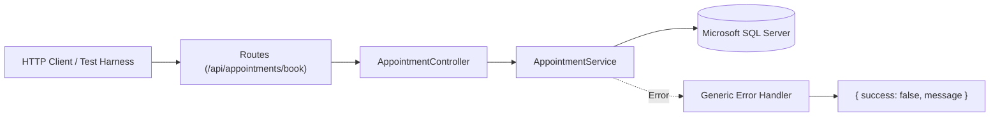
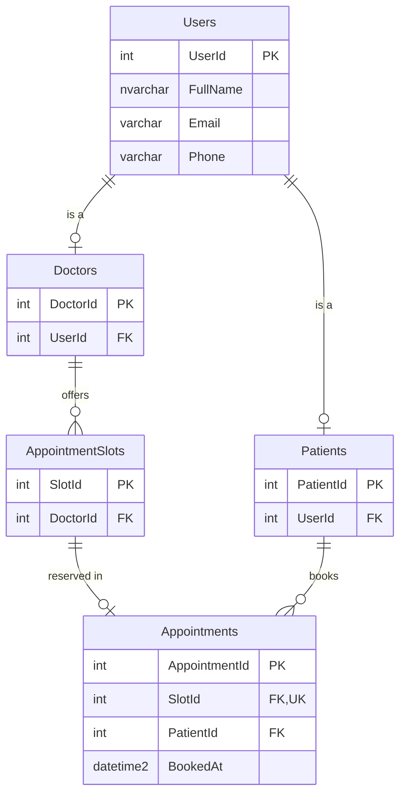

# System Architecture & Database Design

This document provides a concise overview of the monorepo architecture, application flow, and Microsoft SQL Server database schema.

---

## 1. Project Structure

The project is structured as a lightweight monorepo using npm workspaces:

```text
CH-Concurrent-Appointment-Booking-API/
├── apps/
│   └── backend/                   # Express.js REST API service
│       ├── src/
│       │   ├── config/            # Raw environment configurations (db.config.ts)
│       │   ├── features/          # Feature-based business domains
│       │   │   ├── appointments/  # Routes, controller, service & validation
│       │   │   └── health/        # Health check route
│       │   ├── lib/               # Reusable clients (db pool, logger, swagger)
│       │   ├── middleware/        # Global middlewares (error handler, HTTP logger)
│       │   ├── scripts/           # Maintenance scripts (init-db.ts)
│       │   ├── app.ts             # Express app setup & middleware registration
│       │   └── server.ts          # Server bootstrap & listener
│       ├── tests/                 # Automated test suite (Jest + Supertest)
│       │   ├── features/          # Feature-mirrored test suites
│       │   │   └── appointments/  # Schema, API integration, fixture & concurrency tests
│       │   ├── middleware/        # Global middleware tests (errorHandler.test.ts)
│       │   ├── env.ts             # Test environment configuration
│       │   └── setup.ts           # Global test lifecycle hooks (DB pool cleanup)
│       ├── .env                   # Backend environment variables
│       ├── Dockerfile             # Multi-stage Docker container definition
│       ├── jest.config.js         # Jest test runner configuration
│       └── package.json           # Backend dependencies and scripts
│
├── database/                      # Database scripts & storage
│   ├── scripts/                   # DDL & seed scripts
│   │   ├── 01_create_database_and_tables.sql
│   │   └── 02_seed_sample_data.sql
│   └── .env                       # MSSQL container configuration
│
├── tests/                         # Decoupled test harness (pure HTTP client)
│   └── concurrency.test.ts        # Standalone concurrent race condition verification
│
├── docs/                          # Project documentation
│   ├── ARCHITECTURE.md            # System & database architecture (this file)
│   ├── CONCURRENCY_STRATEGY.md    # Explanation of concurrency prevention
│   └── TEST_EXECUTION_RESULTS.md  # Actual test execution results
│
├── docker-compose.yml             # Development stack (MSSQL + Backend)
├── docker-compose.prod.yml        # Production deployment stack
└── package.json                   # Root monorepo workspace manifest
```

---

## 2. Application Flow

The backend follows a clean layered architecture with clear separation of concerns:



1. **Routes & Middleware**: Validates CORS, parses JSON payloads (max 10KB), and correlates requests with `X-Request-Id`.
2. **Controller**: Validates required parameters (`slotId`, `patientId`) and delegates to the service.
3. **Service Layer**: Manages MSSQL transactions, acquires pessimistic row-level locks on `dbo.AppointmentSlots` (`UPDLOCK, ROWLOCK, HOLDLOCK`) while evaluating existing booking state in a single atomic `LEFT JOIN` query, preventing deadlocks. Translates raw database errors (`2601`, `2627`, `1205`) into domain-appropriate errors.
4. **Global Error Handler**: Route-agnostic middleware returning consistent `{ success: false, message }` responses.

---

## 3. Database Schema

The database `CaritasHospitalDB` is organized in Third Normal Form (3NF) to separate user identities, role profiles, available slots, and booked appointments:



### Table Summary

| Table | Primary Key | Description | Key Constraints / Indexes |
|---|---|---|---|
| **`dbo.Users`** | `UserId` (INT) | Core personal identity (name, email, phone) | `UQ_Users_Email`, `UQ_Users_Phone` |
| **`dbo.Doctors`** | `DoctorId` (INT) | Doctor role linked to `Users` | `UQ_Doctors_UserId`, FK to `Users` |
| **`dbo.Patients`** | `PatientId` (INT) | Patient role linked to `Users` | `UQ_Patients_UserId`, FK to `Users` |
| **`dbo.AppointmentSlots`** | `SlotId` (INT) | Available doctor consultation slots | FK to `Doctors` |
| **`dbo.Appointments`** | `AppointmentId` (INT) | Successfully booked appointments | `UQ_Appointments_SlotId` (Unique constraint), FK to `AppointmentSlots`, FK to `Patients` |

### Core Design Rules
- **Derived Availability**: Slot availability is derived from `dbo.Appointments` via `LEFT JOIN ... WHERE AppointmentId IS NULL`. No redundant `IsBooked` column exists on `AppointmentSlots`, eliminating flag synchronization inconsistencies.
- **Hard Concurrency Lock**: `UQ_Appointments_SlotId UNIQUE` constraint ensures that physical database insertion can never occur twice for the same `SlotId`.
