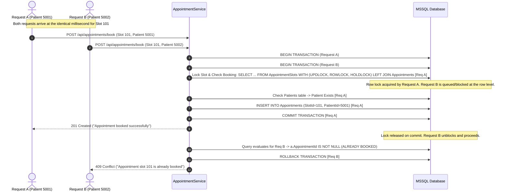

# Concurrency Control Strategy

This document provides a concise explanation of how the API prevents simultaneous booking conflicts, satisfying **Submission Requirement 6**.

---

## 1. The Problem: Race Conditions (TOCTOU)

When two patients attempt to book the same appointment slot simultaneously:
- **Naive approach**: A `SELECT` query checks if the slot is free, followed by an `INSERT`.
- **The flaw**: Both requests execute the `SELECT` at the same instant, see the slot as available, and both execute `INSERT`, resulting in double-booking.

---

## 2. Our Defense-in-Depth Concurrency Strategy

To guarantee that an appointment slot can never be double-booked while maintaining deadlock immunity, the system implements a two-layer concurrency model:



### Layer 1: Pessimistic Row Locking with Combined Availability Check
When reading the slot inside the transaction in `AppointmentService.bookAppointment()`:
```sql
SELECT 
    s.SlotId, 
    s.DoctorId,
    a.AppointmentId
FROM dbo.AppointmentSlots s WITH (UPDLOCK, ROWLOCK, HOLDLOCK)
LEFT JOIN dbo.Appointments a ON s.SlotId = a.SlotId
WHERE s.SlotId = @slotId;
```
- **`UPDLOCK`**: Takes an update lock instead of a shared lock, signaling intent to modify.
- **`ROWLOCK`**: Restricts the lock strictly to the targeted slot row, leaving all other slots unblocked.
- **`HOLDLOCK`**: Holds the lock until the transaction is either committed or rolled back.
- **Atomic Availability Check**: The `LEFT JOIN` checks appointment existence in the exact same query that takes the lock. If `a.AppointmentId` is not null, the request aborts immediately.
- **Deadlock Immunity**: Locks are acquired on `AppointmentSlots` *only*. No locks are taken on `Appointments`, eliminating multi-table lock ordering cycles and key-range index locking on non-existent rows.

**Result**: Only one request can inspect the slot at a time; concurrent requests wait in a queue until the first transaction finishes.

---

### Layer 2: Database Unique Constraint (`UQ_Appointments_SlotId`)
Even under unforeseen race conditions or deadlocks, the database table enforces an inviolable physical guarantee:
```sql
CONSTRAINT UQ_Appointments_SlotId UNIQUE (SlotId)
```
- If two requests bypass application-level checks, Microsoft SQL Server's storage engine rejects the second `INSERT` with error `2601`/`2627` (Unique Constraint Violation).
- The service catches this violation and returns a clean `409 Conflict`.

---

## 3. Transaction Rollback & Consistency

All operations occur inside a dedicated `sql.Transaction`:
- If any validation fails or a conflict occurs, `transaction.rollback()` is immediately executed.
- No partial writes or orphaned records can ever be committed to the database.
